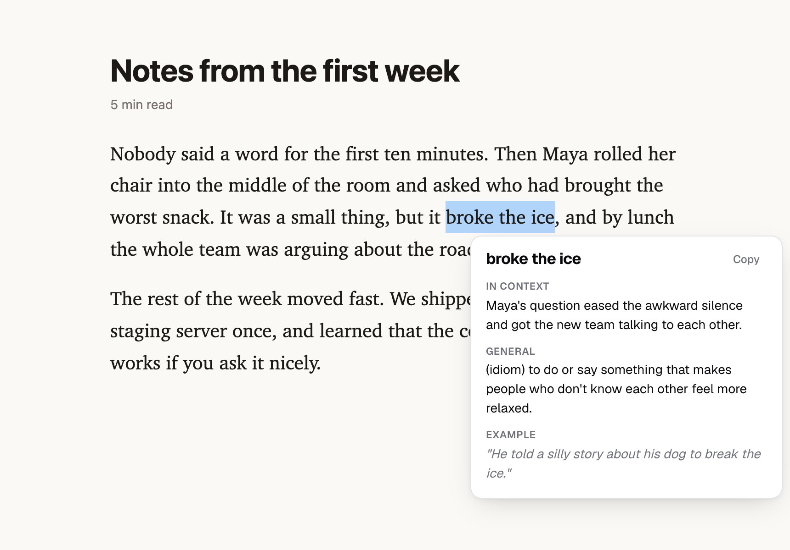
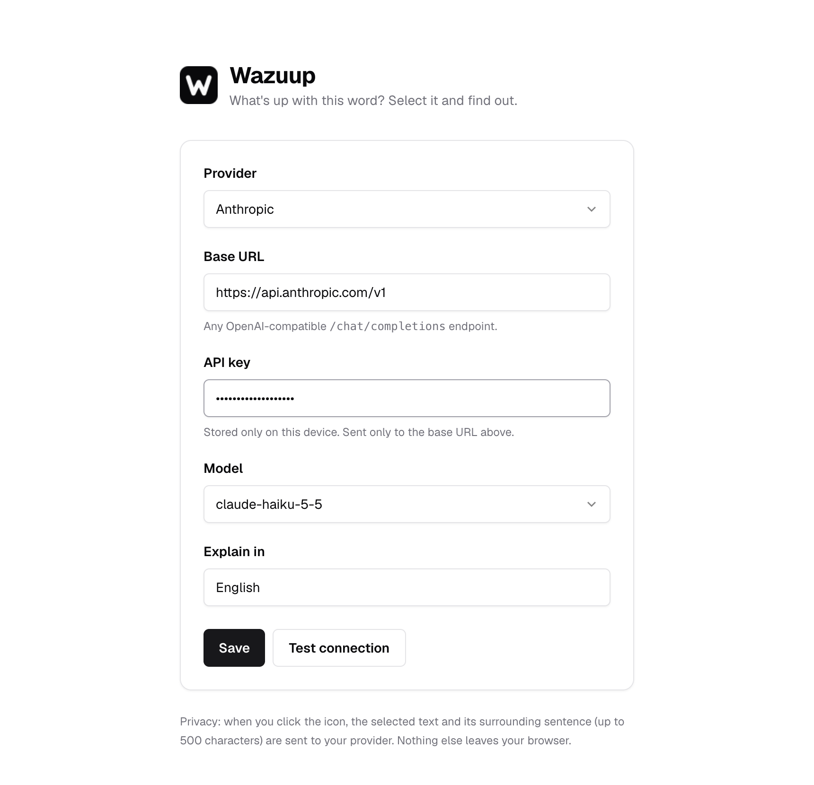

# Wazuup

> *Wazuup* = *"What's up?"*, as in "what's up with this word?"

Select a word or phrase on any page, click the **W** icon, get what it means *in that sentence*.
Open source, bring your own LLM key. Chrome & Edge.

<picture>
  <source media="(prefers-color-scheme: dark)" srcset="docs/popover-dark.png">
  
</picture>

## Install (from source)

```sh
pnpm install
pnpm build          # → dist/chrome-mv3
```

Open `chrome://extensions` (or `edge://extensions`), enable **Developer mode**, click **Load unpacked**, pick `dist/chrome-mv3`.
Settings open automatically. Clicking the toolbar icon opens them again.

Dev mode with hot reload: `pnpm dev` (`pnpm dev:edge` for Edge). Tests: `pnpm test`.

## Providers

Anything that speaks the OpenAI `/chat/completions` format works. There are presets for:

| Provider | Base URL |
|---|---|
| OpenAI | `https://api.openai.com/v1` |
| Anthropic | `https://api.anthropic.com/v1` |
| Gemini | `https://generativelanguage.googleapis.com/v1beta/openai` |
| OpenRouter | `https://openrouter.ai/api/v1` |
| Groq | `https://api.groq.com/openai/v1` |
| Ollama | `http://localhost:11434/v1`, no key needed |
| LM Studio | `http://localhost:1234/v1`, no key needed |



Use a small, fast model. Answers are three short lines. Hit **Test connection** after saving.

**Ollama:** it rejects browser-extension origins by default. Start it with
`OLLAMA_ORIGINS=chrome-extension://* ollama serve`.

## Privacy

- Your API key is stored in `chrome.storage.local` (this device only, never synced) and sent only to the base URL you set.
- When you click the icon, the selected text and its surrounding sentence (max 500 chars) go to your provider. Nothing is sent before you click.
- No analytics, no servers of ours.

## Limitations

- **PDFs:** Chrome's built-in PDF viewer doesn't allow extensions to run, so Wazuup can't work there. Same for `chrome://` pages and the Web Store.
- No icon for text inside inputs/editors, selections over 300 characters, or numbers only.

## Layout

```
entrypoints/background.ts     LLM calls (streaming), session cache, opens settings
entrypoints/content/          selection icon + popover (Shadow DOM, vanilla TS)
entrypoints/options/          settings page (React + Tailwind, shadcn styling)
lib/                          settings, LLM client, pure text helpers (+ tests)
```

MIT licensed.
